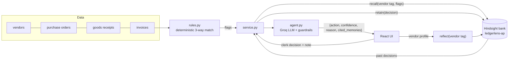

# LedgerLens: AP Exception Agent with Hindsight Memory

An Accounts Payable agent that three-way matches invoices against purchase orders and goods
receipts, flags exceptions, and suggests **approve / hold / escalate**. Every clerk decision is
retained in [Hindsight](https://github.com/vectorize-io/hindsight), so a vendor's recurring
quirks (freight under 2%, rupee rounding, split shipments, a known GST mis-rating) stop needing a
human, while real anomalies (a freight spike, a duplicate with an altered number) still get
stopped.

Built for HackwithHyderabad 3.0.

## Quick start

```bash
python -m venv .venv
.venv\Scripts\activate            # macOS/Linux: source .venv/bin/activate
pip install -r requirements.txt
copy .env.example .env            # then fill in GROQ_API_KEY (and Hindsight, optional)

python scripts/generate_data.py   # already committed in data/, re-run to regenerate
pytest                            # rules, agent guardrails, local memory

uvicorn app.api:app --reload      # API on http://localhost:8000
cd frontend && npm install && npm run dev   # UI on http://localhost:5173
```

For a one-process demo, run `npm run build` in `frontend/`; FastAPI then serves the UI at
http://localhost:8000.

### Environment

| Variable | Purpose |
|---|---|
| `GROQ_API_KEY` | Groq LLM. Model `openai/gpt-oss-120b`; `GROQ_FALLBACK_MODEL` is a comma-separated list (default `qwen/qwen3.8-27b,openai/gpt-oss-20b`) tried in order when a model errors or hits its daily quota |
| `HINDSIGHT_BASE_URL` | Hindsight Cloud (`https://api.hindsight.vectorize.io`) or self-hosted (`http://localhost:8888`). **Empty = local stand-in** |
| `HINDSIGHT_API_KEY` | Hindsight Cloud API key |
| `HINDSIGHT_BANK_ID` | Memory bank, default `ledgerlens-ap` |

Without `HINDSIGHT_BASE_URL`, memory runs in a local stand-in (`var/local_memory.json`) that
exposes the same retain / recall / reflect interface, so development isn't blocked. The header
badge shows which backend is live.

## Architecture



| Module | Role |
|---|---|
| `app/rules.py` | Three-way match. Flags `PRICE_VARIANCE`, `QTY_MISMATCH`, `MISSING_PO`, `DUPLICATE` (fuzzy number + amount + vendor), `TAX_MISMATCH`, `UNEXPECTED_LINE`, `TOTAL_MISMATCH`. No learning here. |
| `app/memory.py` | Thin Hindsight wrapper: `retain_decision`, `recall_vendor_history`, `build_vendor_profile`, plus the MEMORY ON/OFF switch and the local stand-in. |
| `app/agent.py` | LLM call returning `{action, confidence, reason, cited_memories}`. JSON validation, retries, model fallback, deterministic guardrails, safe `escalate` fallback. |
| `app/service.py` | Orchestration, month replay, learning-curve metrics. |
| `app/api.py` | FastAPI endpoints (below). |
| `frontend/` | React + Vite: invoice queue, suggestion card with cited memories, clerk decision, vendor profiles, learning curve, memory toggle. |

### API

| Method | Path | |
|---|---|---|
| GET | `/api/invoices`, `/api/invoices/{id}` | Queue and invoice with PO, GRNs, flags, suggestion, decision |
| POST | `/api/invoices/{id}/suggest` | Recall + agent suggestion |
| POST | `/api/invoices/{id}/decision` | `{action, note}`: records and **retains** the decision |
| GET | `/api/vendors`, `/api/vendors/{id}/memories`, `/api/vendors/{id}/profile` | Vendor list, recalled memories, reflect profile |
| POST | `/api/memory/toggle`, `/api/memory/seed`, `/api/reset` | Memory ON/OFF, seed August history, wipe |
| POST/GET | `/api/replay` | Replay September through day N in the background, and its progress |
| GET | `/api/metrics` | Weekly human-needed rate, agreement |

## How Hindsight memory is used

One bank, `ledgerlens-ap`, created with a mission describing an Indian AP team's institutional
memory and a retain mission that says to keep numbers exact.

1. **retain after every human decision.** The decision is written as a self-contained
   natural-language memory, for example:
   > On 2026-09-01 the AP clerk APPROVED invoice DST/26-27/0140 (INR 85,383.01) from vendor Deccan
   > Steel Traders (V01). Exceptions: UNEXPECTED_LINE - Line 'Freight & forwarding charges'
   > (INR 1,033.58, 1.45% of goods value) is not on the PO. Clerk note: Freight billed separately is
   > agreed with Deccan Steel Traders as long as it stays under 2% of goods value.

   Tags: `vendor:V01`, `flag:UNEXPECTED_LINE`, `decision:approve`. `document_id=decision-<invoice>`,
   so re-deciding replaces the memory instead of duplicating it. The timestamp is the invoice date,
   so temporal recall works.
2. **recall before every suggestion.** The query describes the current exceptions, scoped with
   `tags=["vendor:<id>"], tags_match="any_strict"`, so one vendor's habits never leak into another's.
   The recalled memories go to the LLM as `[M1]…[Mn]`. It must cite the ones it relied on, and the
   UI highlights them on the suggestion card.
3. **reflect for vendor profiles.** Reflect over all of a vendor's memories produces a handling
   guide: accepted quirks with their typical magnitudes, what was held, and guidance for the next
   invoice.

Memory **informs**, guardrails **bound**:
- no approval without at least one cited precedent (with memory off, this is why every
  exception escalates),
- a suspected duplicate is never approved, even if the vendor's rounding quirk is remembered,
- any LLM / JSON failure falls back to `escalate`.

## Synthetic data

`scripts/generate_data.py` (seeded, deterministic) creates 18 Indian vendors with valid-checksum
GSTINs, INR amounts, CGST+SGST vs IGST by state, and payment terms. Each vendor has 1-2
consistent quirks:

| Quirk | Flag it triggers |
|---|---|
| Freight billed separately, < 2% | `UNEXPECTED_LINE` |
| Totals rounded to the rupee | `TOTAL_MISMATCH` |
| Split shipments invoiced in full | `QTY_MISMATCH` |
| Wrong GST rate, monthly credit note (e.g. cement billed at 28% vs 18%) | `TAX_MISMATCH` |
| Commodity escalation clause ≤ 3% | `PRICE_VARIANCE` |
| Monthly services without PO | `MISSING_PO` |

There are two genuine anomalies: **Coromandel Engineering Works** bills 9.6% freight (history is
~1.5%), and **Lakshmi Hardware Mart** re-sends an invoice with `-A` appended to the number.
`history.json` holds 36 clerk decisions from August. `ground_truth.json` drives the simulated
clerk during replay and is never shown to the agent.

## Demo script

1. **Fresh memory.** Learning → *Reset all*. In the queue, open INV-0001 (Deccan Steel, freight
   1.45%) → *Ask LedgerLens* → **escalate** (no precedent). Approve with the note "Freight under 2%
   is agreed in contract". The retained memory is shown.
2. **Replay a month.** Learning → *Replay month* through day 22. Week 1 is mostly escalations;
   by weeks 3-4 repeat quirks are **approved**, each citing past decisions.
3. **Anomalies.** Open the Lakshmi Hardware `-A` invoice (day 24): **hold**, duplicate guardrail.
   Open Coromandel's day-26 invoice: freight 9.6% vs ~1.5% learned → **hold**.
4. **Vendor profile.** Vendor memory → *Build profile from memory* (reflect). The learning-curve
   chart shows human-needed exceptions dropping week over week.
5. **Memory OFF.** Toggle it in the header and ask again on any quirky invoice. It escalates like a
   generic rules bot.

Shortcut: *Seed August history* before replaying and the agent starts September already knowing
every vendor.
